GenAI 기초 - 노코드 자동화

# Project 1. 자동화 도구 비교 구현

Make vs Zapier 비교 분석

보고서 목적 동일한 자동화 업무를 Make와 Zapier에 각각 구현한 결과물을 과제 요구사항에
맞춰 정리하고, 실제 실행 증빙·비교 항목·요금/보안 리스크를 점검한 보고서입니다.

작성 기준일  2026. 8. 16.

## 1. 과제 개요 및 최종 판단

### 1.1 과제 목표

서로 다른 2개 이상의 노코드 자동화 도구를 직접 사용하여 동일한 워크플로우를 구현하고,
Trigger·Action·조건 분기·실행 결과를 실제로 확인한 뒤 도구별 특성을 비교 분석하는
과제이다.

| 평가 항목 | 최종 판단 | 근거/보완 내용 |
| --- | --- | --- |
| 서로 다른 자동화 도구 2개 이상 | 충족 | Make와 Zapier를 실제 사용 |
| 동일한 워크플로우 구조 | 충족 | Google Sheets 새 행 감지 → 처리이력 기록 → 80점 기준 분기 → Gmail 통보 |
| Trigger 1개 이상 | 충족 | 양 도구 모두 Google Sheets의 신규 응답 행을 시작점으로 사용 |
| Action 2개 이상 | 충족 | ① 처리이력 시트 행 추가 ② Gmail 이메일 발송 |
| 조건 분기 1개 이상 | 충족 | Make Router+Filter / Zapier Paths 조건 분기 |
| 분기 경로별 1회 이상 실행 | 충족 | 83점 합격과 71점 재응시 사례가 실제 발송되었고 Zapier는 양쪽 Path 실행 화면이 확인된다. Make도 동일 입력에 반응한 실행 기록이 있음 |
| 비교 항목 5개 이상 | 충족 | 본 보고서에서 10개 항목 비교 |
| 도구별 장단점 | 충족 | 7장에 정리 |
| 적합 상황 의견 | 충족 | 8장에 정리 |
| 민감정보 마스킹 | 충족 | 최종보고서 삽입 화면은 계정 식별부를 블러 처리 |
| 유료 기능 사용 사유/무료 대안 | 충족 | Make는 Free 범위의 Router/Filter를 활용. Zapier는 Paths를 포함한 다단계 구성을 위해 신규 계정의 Professional 14일 무료체험을 활용했으며, 무료 대안은 동일 과제에서 사용한 Make의 Router/Filter 구성임 |

## 2. 자동화 업무 정의

- 자동화 업무: Google Form으로 입력된 평가 결과가 Google Sheets에 저장되면 해당
응답을 별도의 처리이력 시트에 기록하고, 점수가 80점 이상인지 여부에 따라 합격
또는 재응시 안내 이메일을 자동 발송한다.
- 입력 데이터: Google Form 응답이 연결된 Google Sheets 행
- 판정 기준: 점수 80점 이상 = 합격 / 80점 미만 = 재응시
- 기록: 동일 응답을 「처리이력」 시트에 추가
- 통보: Gmail을 이용하여 결과 이메일 자동 발송
- 비교 도구: Make, Zapier

| 단계 | 역할 | 처리 내용 |
| --- | --- | --- |
| 1 | Trigger | Google Sheets에서 신규 응답 행 감지 |
| 2 | Action 1 | 처리이력 시트에 응답 정보 추가 |
| 3 | 조건 분기 | 점수 ≥ 80 / 점수 < 80 |
| 4-A | Action 2 | 합격 안내 이메일 발송 |
| 4-B | Action 2 | 재응시 안내 이메일 발송 |

## 3. Make 구현

### 3.1 구성

| 구분 | Make 구성 |
| --- | --- |
| Trigger | Google Sheets - Watch New Rows (신규 응답 행 감지) |
| Action 1 | Google Sheets - Add a Row (처리이력 기록) |
| 조건 분기 | Router + 두 개의 Filter (80점 이상 / 80점 미만) |
| Action 2-A | Gmail - Send an Email (합격 안내) |
| Action 2-B | Gmail - Send an Email (재응시 안내) |

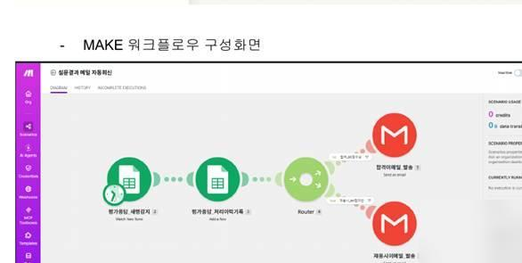

그림 1. Make 워크플로우 구성 화면
Make 화면에서는 Google Sheets 모듈 2개 뒤에 Router가 배치되고, Router에서
합격/재응시 두 경로로 나뉘어 각각 Gmail 발송 모듈로 연결되어 있다. 이는 Trigger 1개,
Action 2개 이상, 조건 분기 1개 이상이라는 공통 요구사항을 구조적으로 충족한다.

### 3.2 실행 및 로그 확인

- Scenario를 Run once로 실행하거나 스케줄을 활성화한 뒤 신규 행을 입력한다.
- 모듈 위 실행 버블에서 처리된 bundle과 input/output 값을 확인할 수 있다.
- History의 개별 실행 건에서 단계별 실행 이력과 처리 데이터를 확인할 수 있다.
- 보고서 작성 시점(2026.8.16.)에는 과거 실행의 Details가 조회되지 않았다. Make
Free 플랜의 상세 실행 로그 저장기간은 7일이고 해당 실행은 약 14일 전이라서 보관
기간이 경과되었음

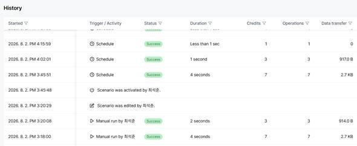

그림 2. Make History 실행 목록

## 4. Zapier 구현

### 4.1 구성

| 구분 | Zapier 구성 |
| --- | --- |
| Trigger | Google Sheets - 신규 Spreadsheet Row 감지 |
| Action 1 | Google Sheets - 처리이력 Row 생성 |
| 조건 분기 | Paths - 두 경로로 분기 |
| Action 2-A | Gmail - Send Email (합격 안내) |
| Action 2-B | Gmail - Send Email (재응시 안내) |

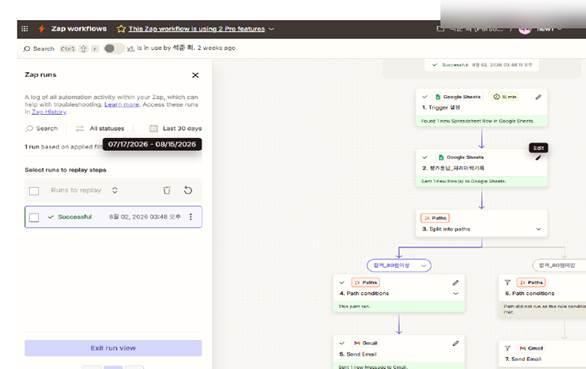

그림 3. Zapier 워크플로우 구성 및 성공 Run 화면
Zapier Free 플랜은 2-step Zap 중심이어서 이번처럼 Paths를 포함한 다단계 분기
워크플로우를 게시하기 어렵다. 본 구현에서는 신규 계정에 제공되는 Professional 14일
무료체험을 활용하였다.

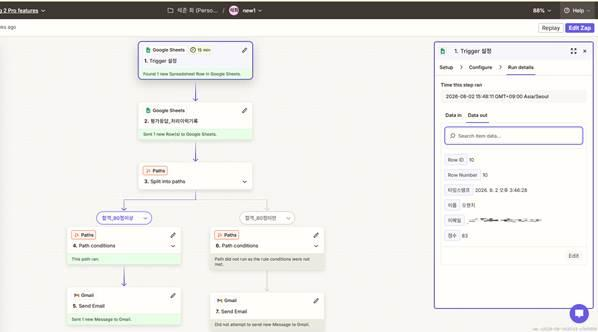

그림 4. Zapier 합격 분류 사례

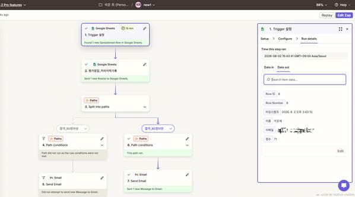

그림 5. Zapier 재응시 분류 사례

### 4.2 실행 및 로그 확인

- Zap runs에서 개별 실행 건의 성공/실패 여부를 확인한다.
- Zapier의 task는 성공적으로 실행된 Action을 기준으로 계산되며 Trigger와
Filter/Paths는 task로 계산되지 않는다. 따라서 폴링 자체가 task로 계산되지 않는
점은 Make의 credits 관리 방식과 비교할 때 사용량 관리 측면의 차이로 볼 수 있다.

## 5. 실제 실행 결과 및 분기 검증

기존 Google Forms/Sheets 화면에는 총 9건의 응답이 제시되어 있고 점수는 85, 100, 99,
22, 50, 85, 71, 82, 83점이다. 80점 기준으로 계산하면 합격 6건, 재응시 3건이다.
워크플로우 설계 과정의 테스트 데이터가 포함되어 있으며, 두 자동화 도구를 완성하고
동시에 실행한 15시 20분 이후의 데이터는 동일 입력에 Make와 Zapier가 모두 반응했음을
보여 주는 근거로 사용하였다.

| 테스트 유형 | 대표 점수 | 예상 경로 | 결과 |
| --- | --- | --- | --- |
| 합격 경로 | 83점 | 80점 이상 → 합격 이메일 | 합격 안내 이메일 발송 확인 |
| 재응시 경로 | 71점 | 80점 미만 → 재응시 이메일 | 재응시 안내 이메일 발송 확인 |

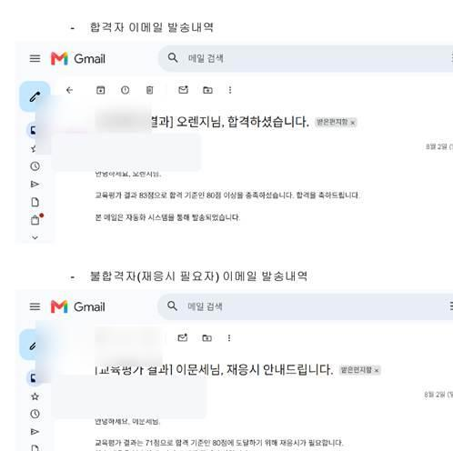

그림 6. 합격(83점)·재응시(71점) 이메일 실제 발송 결과

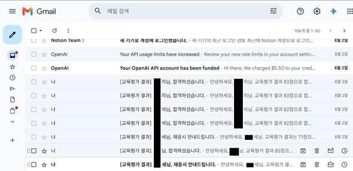

그림 7. Gmail 발송 목록 확인 화면

## 6. Make vs Zapier 비교 분석

| 비교 항목 | Make | Zapier | 본 과제 관점 평가 |
| --- | --- | --- | --- |
| 1. UI/UX | 캔버스 위 모듈 연결의 시각적 노드 방식. 전체 분기 구조를 한눈에 보기 쉬움. | 단계별 카드/리스트 중심. 초보자가 순서대로 설정하기 쉬움. | 복잡한 분기를 설명하는 발표·보고서에는 Make가 직관적. |
| 2. 초기 설정 난이도 | Mapping, bundle, router/filter 개념을 익혀야 해 초기 학습량이 있음. | Trigger와 Action을 순서대로 안내해 초반 진입이 쉬운 편. | 초보자 시작은 Zapier, 구조 이해·확장은 Make가 유리. |
| 3. 조건 분기 | Router & Filters가 Free에 포함. | Paths는 Free에서 사용할 수 없고 다단계 구성은 Professional 이상 또는 무료체험이 필요. | 무료 수행이 중요하면 Make가 우세. |
| 4. 연동 앱 범위 | 공식 페이지 기준 3,000+ 앱. | 공식 페이지 기준 9,000+ 앱. | 서비스 수는 Zapier가 더 넓지만 본 과제의 Google Sheets/Gmail은 둘 다 지원. |
| 5. 무료 플랜 | 1,000 credits/월, Router/Filter 포함, 최소 15분 실행 간격. | 100 tasks/월, Free는 one trigger + one action의 2-step Zap. | 이번 다단계 분기 워크플로우는 Make Free가 현실적으로 유리. |
| 6. 사용량 계산 | 모듈 실행이 credits에 영향을 주며 스케줄 운영 방식에 따라 credits 관리가 중요. | 성공한 Action이 task로 계산되고 Trigger·Filter·Paths는 task 미계산. | Make는 credits/스케줄 관리, Zapier는 Action 수 관리가 핵심. |
| 7. 실행 로그 | History와 각 모듈의 bundle input/output를 상세히 확인 가능. | Zap runs에서 실행 상태와 단계별 상태를 확인. Filtered 등 상태 표현이 명확. | 데이터 흐름 디버깅은 Make가 세밀하고 실행 상태 파악은 Zapier가 간결. |
| 8. 분기 시각화 | Router에서 여러 갈래를 한 화면에 표현하기 좋음. | Paths로 분기하지만 카드가 세로로 길어질 수 있음. | 과제의 조건 분기 설명에는 Make 화면이 더 설명하기 쉬움. |
| 9. 중복/테스트 관리 | Run once와 시작 지점 설정 등 테스트 제어가 강력하나 활성화·스케줄 관리에 주의 필요. | 개별 Zap run 기록이 명확하지만 Pro 기능/Task 한도를 함께 관리해야 함. | 두 도구 동시 테스트 시 별도 시간대 또는 Tool 열을 두는 것이 좋음. |
| 10. 추천 상황 | 복잡한 분기, 다단계 데이터 변환, 비용 민감 실습, 시각적 설계가 중요한 경우. | 많은 앱 연동, 간단한 업무를 빠르게 구성, 안내형 UI를 선호하고 유료 플랜 사용이 가능한 경우. | 이번 동일 분기 비교에서는 Make를 기준 구현, Zapier를 비교 구현으로 두는 구성이 설득력 있음. |

## 7. 도구별 장단점 정리

### 7.1 Make

| 구분 | 내용 |
| --- | --- |
| 장점 | ① Router/Filter가 무료 플랜에 포함되어 과제 요구 충족이 쉽다. ② 전체 흐름이 시각적으로 보여 분기 구조 설명이 쉽다. ③ bundle 단위 input/output 확인이 상세하다. ④ 복잡한 다단계 자동화 확장성이 좋다. |
| 단점 | ① 초보자에게 Mapping, bundle, credits 개념이 어렵다. ② 폴링형 Trigger를 스케줄로 운영하면 정기 실행에 따른 credits 관리가 필요하다. ③ 여러 분기와 모듈이 늘어나면 화면이 복잡해질 수 있다. |

### 7.2 Zapier

| 구분 | 내용 |
| --- | --- |
| 장점 | ① 단계별 설정 방식이 명확해 초보자가 따라가기 쉽다. ② 연동 앱 생태계가 매우 넓다. ③ Zap runs에서 성공/Filtered/Errored 등 상태를 파악하기 쉽다. |
| 단점 | ① Free는 2-step Zap으로 제한되어 본 과제와 같은 다단계 분기 구현에 적합하지 않다. ② Paths와 다단계 워크플로우는 Professional 이상 또는 무료체험이 필요하다. |

## 8. 어떤 상황에 어떤 도구가 적합한가

- Make가 더 적합: 무료 범위에서 Router/Filter를 써야 하는 교육 실습, 여러 조건
분기, 데이터 변환 단계가 많은 업무, 실행 데이터의 세밀한 디버깅이 필요한 경우.
- Zapier가 더 적합: 연결하려는 서비스 종류가 매우 많고, 간단한 자동화를 빠르게
만들고 싶으며, Professional 이상 플랜 또는 무료체험을 사용할 수 있는 경우.
- 이번 과제의 판단: 같은 평가 자동화를 두 도구로 비교하는 목적에는 두 제품 모두
적절하지만, “무료 플랜 우선” 조건까지 고려하면 Make 쪽이 과제 요구와 더 잘
맞는다.

## 9. 보안 및 제출물 처리

- API Key, OAuth token, 비밀번호는 어떤 화면에도 노출하지 않는다.
- Gmail/Google 계정 이메일은 전체 주소를 그대로 보여 주지 않고 일부 마스킹 또는
블러 처리한다.
- 본 최종보고서에 삽입한 화면은 계정 식별 영역을 블러 처리한 버전을 사용했다.
- Google Sheets 응답자 이메일은 제출 목적상 전체 주소가 필요하지 않으므로 ***
또는 부분 마스킹으로 처리한다.
- 공유 링크를 제출할 경우 “링크가 있는 모든 사용자 편집 가능” 같은 과도한 권한을
피하고 최소 권한 원칙을 적용한다.

## 10. 최종 결론

기존 구현은 Google Sheets 신규 응답을 Trigger로 하여 처리이력 기록, 80점 기준 조건
분기, Gmail 결과 통보를 Make와 Zapier에서 각각 실행한 것으로 확인된다. 따라서 Project
1의 핵심인 “두 도구를 직접 사용한 동일 워크플로우 비교 구현”은 성립한다. 다만 평가
증빙의 명확성을 높이기 위해서는 Make에서도 합격/재응시 각 분기의 상세 Run 로그를
별도로 확보해 두는 것이 가장 확실하다.

GenAI 기초 - 노코드 자동화

# Project 2. 자유 주제 자동화 설계 및 구현
Google Form 평가 결과 자동 판정 · AI 맞춤 안내 · 오류 대응 자동화
작성 기준일  2026. 8. 16.

## 목차

## 1. 과제 개요 및 최종 판단

## 2. 자동화할 반복 업무 정의

## 3. 자동화 도구 선정 및 선정 이유

## 4. 워크플로우 설계

## 5. Make 구현 내용

## 6. 실제 실행 결과 및 분기 검증

## 7. Bonus 1 - AI 연동 Action

## 8. Bonus 2 - 실패 알림 및 재시도/대체 경로

## 9. 보안 및 개인정보 보호

## 10. 자동 실행·테스트·운영 관점 검토

## 11. 최종 결론

## 1. 과제 개요 및 최종 판단

### 1.1 과제 목표

Project 2는 반복 업무 1개를 정의하고 자동화 도구 1개를 선택한 뒤, 실제로 자동 실행되는
워크플로우를 구현하여 설계 흐름·구현 화면·실행 결과를 증빙하는 과제이다. 공통
요구사항으로 Trigger 1개 이상, Action 2개 이상, 조건 분기(Filter/Router) 1개 이상이
필요하며, 분기 구조를 사용했다면 각 분기 경로가 실제로 최소 1회 이상 실행되었음을
확인해야 한다. Bonus 1은 생성형 AI Action, Bonus 2는 실패 알림과 재시도 또는 대체 경로
설계이다.

### 1.2 요구사항 충족 여부

| 평가 항목 | 최종 판단 | 근거/보완 내용 |
| --- | --- | --- |
| 반복 업무 1개 정의 | 충족 | Google Form 평가 결과를 자동 판정·기록·메일 통보하는 업무로 정의 |
| 자동화 도구 1개 선정 및 이유 | 충족 | Make 선정, Router/Filter·시각적 분기·무료 범위 관점에서 이유 제시 |
| 자동 실행 구조 | 충족 | Google Sheets Watch New Rows + History의 Schedule 성공 실행 확인 |
| 워크플로우 흐름 설명/도식 | 충족 | 본 보고서 4장에서 단계별 표와 도식으로 재구성 |
| 구현 화면 캡처 | 충족 | Make 시나리오 전체 구조 화면 존재 |
| 실행 결과 화면 캡처 | 충족 | 합격·재응시·부적합 입력 결과 및 Gmail 발송 화면 존재 |
| Trigger 1개 이상 | 충족 | Google Sheets - Watch New Rows |
| Action 2개 이상 | 충족 | AI 문안 생성, Sheets 기록, Gmail 발송 등 다수 Action |
| 조건 분기 1개 이상 | 충족 | 입력값 판정 Router + 정상 입력 결과 판정 Router |
| 분기 경로별 실제 실행 | 충족 | 98점 합격, 66점 재응시, 101점 부적합 입력 사례로 주요 경로 확인 |
| Bonus 1 AI 연동 | 충족 | 합격/재응시 각각 Simple Text Prompt AI 모듈 사용 및 서로 다른 문안 생성 확인 |
| Bonus 2 실패 알림/대체 경로 | 구조 충족 | AI 모듈 오류 처리 경로(에러 시트→Gmail→Resume) 확인. 다만 “실제 AI 모듈 실패를 강제로 발생시킨 실행 결과는 없음 |

## 2. 자동화할 반복 업무 정의

자동화 대상은 「AI 기초교육 평가 결과 자동 판정 및 안내」 업무이다. 사람이 매번 Google
Form 응답을 확인하고 점수를 판정하여 개별 메일을 작성하는 반복 업무를 자동화한다.

| 구분 | 설계 내용 |
| --- | --- |
| 입력 | Google Form 응답이 연결된 Google Sheets 신규 행: 접수시각, 이름, 이메일, 점수 |
| 입력 검증 | 필수값 누락 여부와 정상 점수 범위를 확인. 부적합하면 합격/재응시 판정을 중단 |
| 판정 기준 | 점수 80점 이상 = 합격 / 80점 미만 = 재응시 |
| AI 처리 | 합격·재응시 유형별로 AI가 개인화 안내문을 생성 |
| 기록 | 합격자/재응시자 시트에 처리 결과와 AI 안내문 기록 |
| 통보 | Gmail로 해당 응시자에게 결과 안내 자동 발송 |
| 부적합 입력 | 실패로그에 기록하고 관리자에게 확인 필요 메일 발송. 응시자 결과 메일은 보내지 않음 |
| AI/후속 오류 | 오류 처리 경로에서 에러 발생 시트 기록 → 관리자 Gmail → Resume로 흐름 종료/계속 처리 |

### 2.1 자동화 전·후 비교

| 구분 | 내용 |
| --- | --- |
| 수작업 | 응답 확인 → 점수 판정 → 메일 문안 작성 → 대상자 메일 발송 → 결과 기록 → 오류 확인을 사람이 반복 |
| 자동화 후 | 신규 응답 감지부터 판정·AI 문안 작성·시트 기록·메일 발송·오류 관리자 통보까지 시나리오가 자동 수행 |
| 업무 효과 | 판정 누락과 메일 작성 반복을 줄이고, 정상/비정상 입력을 분리하여 잘못된 결과 메일 발송 위험을 줄임 |

## 3. 자동화 도구 선정 및 선정 이유

### 3.1 선정 도구: Make

Project 1에서 Make와 Zapier를 비교한 경험을 바탕으로 Project 2는 Make를 선택하였다.
현재 Make 공식 가격표에서도 Free 플랜에 1,000 credits/month, Routers & filters, 15-minute

minimum interval이 포함되는 것으로 안내되어 있어, 다중 분기 구조를 교육 과제로
구현하기에 적합하다(2026.8.16. 확인).

| 선정 근거 | 설명 |
| --- | --- |
| 조건 분기 | Router/Filter를 시각적으로 한 화면에 배치할 수 있어 입력 검증·합격·재응시·오류 경로를 설명하기 쉬움 |
| 무료 실습 범위 | 현재 Free 플랜에 Router & filters와 1,000 credits/month가 포함되어 과제 실습에 유리 |
| AI 확장 | Make AI Toolkit/AI Provider를 이용한 AI Action을 동일 시나리오에 연결 가능 |
| 오류 처리 | Error Handler, Resume, Retry 등 오류 처리 기능이 있어 Bonus 2 확장에 적합 |
| 증빙성 | 시나리오 캔버스 자체가 설계도 역할을 하며 History에서 실행 상태를 확인할 수 있음 |

### 3.2 선정 시 유의점

- Google Sheets의 Watch New Rows는 폴링형 Trigger이므로 스케줄을 계속 켜 두면
정기 실행에 따른 credits가 발생할 수 있다. 실습 종료 후 불필요한 Scenario는
비활성화하는 것이 안전하다.
- 복잡한 분기에서는 모듈 수가 빠르게 늘어나므로 “입력 검증 → 정상 판정 → 결과
처리 → 오류 처리”처럼 단계별 이름을 명확히 붙이는 것이 중요하다.
- AI 생성 문안은 편리하지만, AI 실패 시에도 잘못된 응시자 메일이 발송되지 않도록
대체 경로와 관리자 확인 절차가 필요하다.

## 4. 워크플로우 설계

### 4.1 전체 흐름

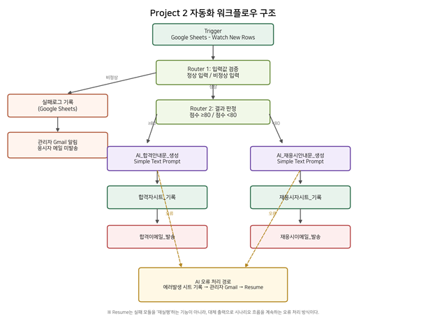

그림 1. Project 2 최종 워크플로우 구조(제출자료를 기반으로 재구성)

### 4.2 단계별 모듈 구성

| 단계 | 역할 | 모듈/분기 | 처리 내용 |
| --- | --- | --- | --- |
| 1 | Trigger | Google Sheets - Watch New Rows | Google Form 응답 시트에서 신규 행 감지 |
| 2 | Router 1 | 입력판정 | 정상 입력과 비정상 입력을 분리 |
| 2-A | Action | Google Sheets - Add a Row | 비정상 입력을 실패로그에 기록 |
| 2-B | Action | Gmail - Send an Email | 비정상 입력 관리자 알림, 응시자에게는 결과 메일 미발송 |
| 3 | Router 2 | 정상입력/결과 판정 | 정상 입력을 점수 80점 기준으로 합격·재응시 분리 |
| 4-A | AI Action | AI_합격안내문_생성 - Simple Text Prompt | 합격자용 개인화 안내문 생성 |
| 5-A | Action | 합격자시트_기록 - Add a Row | 합격 판정과 AI 생성 문안 기록 |
| 6-A | Action | 합격이메일_발송 - Gmail | 합격 안내 메일 발송 |
| 4-B | AI Action | AI_재응시안내문_생성 - Simple Text Prompt | 재응시자용 개인화 안내문 생성 |
| 5-B | Action | 재응시자시트_기록 - Add a Row | 재응시 판정과 AI 생성 문안 기록 |
| 6-B | Action | 재응시이메일_발송 - Gmail | 재응시 안내 메일 발송 |
| E-A | Error Handler | 합격자에러발생 → Gmail → Resume | 합격 AI/후속 처리 실패 시 오류 기록·관리자 통보·대체 흐름 |
| E-B | Error Handler | 재응시에러발생 → Gmail → Resume | 재응시 AI/후속 처리 실패 시 오류 기록·관리자 통보·대체 흐름 |

### 4.3 입력 검증을 첫 단계에 둔 이유

- 잘못된 점수나 필수값 누락을 AI 호출 전에 차단하여 불필요한 AI credits와 Gmail
발송을 줄인다.
- 101점처럼 정상 범위를 벗어난 값이 들어와도 합격으로 오판하지 않고 “판정
불가”로 분리할 수 있다.
- 오류를 응시자에게 그대로 노출하지 않고 관리자에게만 원본 데이터와 오류 사유를
알려 수동 수정이 가능하다.

## 5. Make 구현 내용

### 5.1 전체 구현 화면

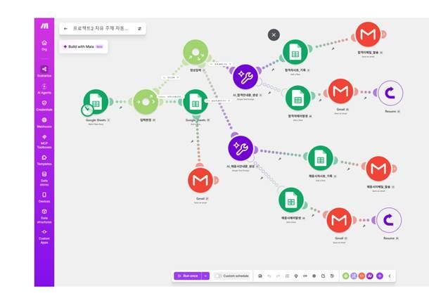

그림 2. Make 시나리오 전체 구현 화면(기존 Project 2 보고서 p.1 기반)
화면에서는 Google Sheets Trigger 뒤에 “입력판정” Router가 있고, 정상 입력은 “정상입력”
Router로 이동하여 합격/재응시 두 경로로 분기된다. 비정상 입력은 Google Sheets
실패기록 및 관리자 Gmail 경로로 이동한다. 합격·재응시 경로에는 각각 Simple Text Prompt
AI 모듈, 결과 시트 기록, Gmail 발송이 연결되어 있다. 또한 AI 모듈의 오류 처리 점선
경로는 별도의 에러발생 시트, Gmail, Resume로 연결되어 있다.

### 5.2 자동 실행 구조

Trigger는 Google Sheets - Watch New Rows이며 Scenario가 활성화되면 설정된 스케줄에
따라 신규 행을 확인한다. 기존 보고서 p.6의 History에는 “Schedule” 실행이 Success로
표시되어 있어 수동 Run once뿐 아니라 자동 실행 구조가 작동한 기록도 확인된다.

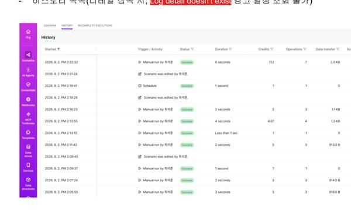

그림 3. Make History 실행 목록 - Manual run과 Schedule 성공 기록(기존 보고서 p.6 기반)
2026.8.16. Make 공식 가격표에는 Free 플랜의 detailed execution log storage가 7일로
안내된다. 제출자료의 실행일은 2026.8.2., 보고서 작성일은 2026.8.16.으로 약 14일
차이가 있으므로, 상세 로그가 사라진 주된 원인은 “무료 플랜 로그 보관기간 경과”에
해당함

## 6. 실제 실행 결과 및 분기 검증

### 6.1 분기 검증 요약

| 테스트 경로 | 대표 입력 | 예상/확인 흐름 | 결과 |
| --- | --- | --- | --- |
| 합격 경로 | 98점 | 정상 입력 → 점수 ≥80 → AI 합격문 생성 → 합격자 시트 → 합격 메일 | 확인 |
| 재응시 경로 | 66점 | 정상 입력 → 점수 <80 → AI 재응시문 생성 → 재응시 시트 → 재응시 메일 | 확인 |
| 비정상 입력 경로 | 101점 | 입력값 검증 실패 → 판정 중단 → 실패로그 → 관리자 메일 → 응시자 메일 미발송 | 확인 |

### 6.2 합격 경로 실행

기존 결과 시트에는 99점·98점 합격 사례가 기록되어 있고, AI가 생성한 안내 문안이 서로
다른 것을 확인할 수 있다. 이는 단순 고정 템플릿 발송이 아니라 AI Action의 결과가 실제
후속 단계로 전달되었음을 보여 준다.

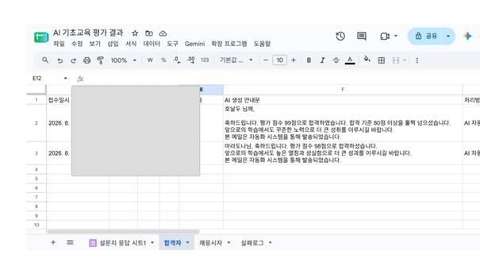

그림 4. 합격자 처리 시트 - AI 생성 안내문 기록(개인 식별정보 마스킹)

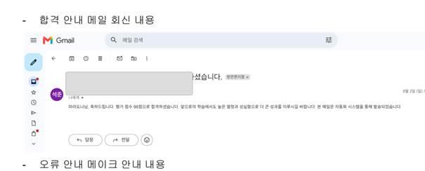

그림 5. 합격 안내 Gmail 실제 발송 화면(개인 식별정보 마스킹)

### 6.3 재응시 경로 실행

66점 사례는 80점 미만 조건으로 재응시 경로를 통과하며, AI가 생성한 재응시 안내문이
재응시자 시트에 기록되고 Gmail로 발송되었다. 이로써 결과 판정 Router의 양쪽 경로가
모두 최소 1회 이상 실제 실행되었음을 확인할 수 있다.

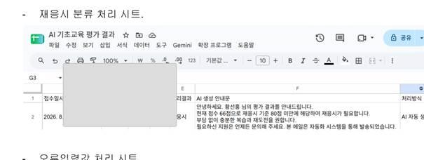

그림 6. 재응시 처리 시트 - AI 생성 안내문 기록(개인 식별정보 마스킹)

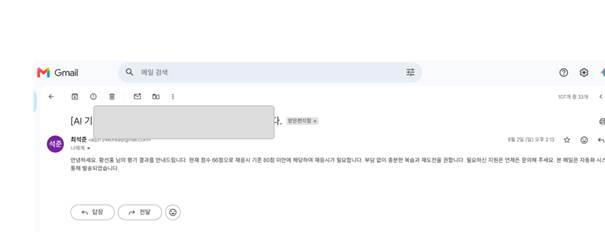

그림 7. 재응시 안내 Gmail 실제 발송 화면(개인 식별정보 마스킹)

### 6.4 비정상 입력 경로 실행

101점 입력 사례는 정상 점수 범위를 벗어난 값으로 처리되어 합격·재응시 판정을 진행하지
않았다. 실패로그에는 입력값 검증 단계, 판정 불가, 유효하지 않은 입력, 관리자 수동 확인,
응시자 미발송 등의 처리 결과가 기록되어 있으며 관리자에게 확인 필요 메일이
발송되었다.

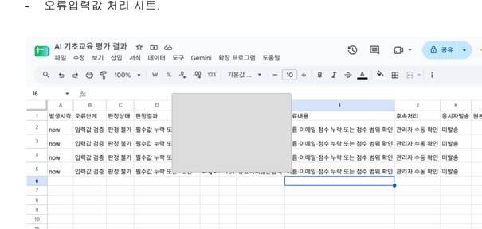

그림 8. 비정상 입력 실패로그(개인 식별정보 마스킹)

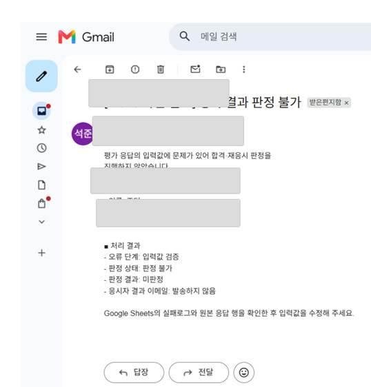

그림 9. 비정상 입력 관리자 확인 요청 Gmail(개인 식별정보 마스킹)

분기 요구사항 관점
과제의 “조건 분기 구조가 포함된 경우 각 분기 경로를 실제로 1회 이상 실행” 요구에
대해, 정상 입력 Router의 합격/재응시 양쪽 경로와 입력 검증 Router의 비정상 경로까지
실행 결과가 존재함.

## 7. Bonus 1 - AI 연동 Action

### 7.1 구현 내용

합격 경로에는 「AI_합격안내문_생성」, 재응시 경로에는 「AI_재응시안내문_생성」 Simple
Text Prompt 모듈이 배치되어 있다. AI 출력은 각각 합격자/재응시자 시트의 “AI 생성
안내문” 필드에 저장되고 Gmail 본문으로 사용된다.

| 경로 | AI 입력 | AI 출력 역할 | 후속 사용 |
| --- | --- | --- | --- |
| 합격 | 점수·이름 등 입력 정보 | 축하 문구 + 합격 기준 충족 안내 + 향후 학습 격려 | 합격자 시트 및 Gmail |
| 재응시 | 점수·이름 등 입력 정보 | 현재 점수 안내 + 재응시 필요 안내 + 격려 문구 | 재응시자 시트 및 Gmail |

### 7.2 AI 사용의 실제 가치

- 동일한 판정 결과라도 사용자별 안내 문장을 다르게 생성하여 고정 템플릿보다
자연스러운 메시지를 만들 수 있다.
- AI 출력이 시트에 함께 기록되므로 “무슨 문구가 실제 발송되었는지” 사후 확인이
가능하다.
- AI 생성 실패 시 별도 오류 처리 경로를 두어 AI가 전체 자동화의 단일 실패 지점이
되지 않도록 설계하였다.

### 7.3 AI 자동 안내문 생성 프롬프트

#### 7.3.1     합격자 AI 자동 안내문 생성 프롬프트

당신은 교육평가 결과 안내 이메일을 작성하는 행정업무 보조자입니다.
아래 정보를 사용하여 합격 안내 이메일 본문을 작성하세요.
[평가 정보]
이름: {{2.`1`}}
점수: {{2.`3`}}점
평가결과: 합격
합격기준: 80점 이상
[작성 규칙]

## 1. 입력된 이름과 점수를 정확하게 사용하세요.

## 2. 합격을 축하하고 앞으로의 학습을 격려하세요.

## 3. 입력되지 않은 일정, 장소, 담당자 정보는 만들지 마세요.

## 4. 한국어 존댓말로 작성하세요.

## 5. 이메일 제목이나 마크다운 기호는 출력하지 마세요.

## 6. 이메일 본문만 출력하세요.

## 7. 전체 분량은 200자 이내로 작성하세요.

## 8. 마지막에 ‘본 메일은 자동화 시스템을 통해 발송되었습니다.’를 넣으세요.

#### 7.3.2      재응시자 AI 자동 안내문 생성 프롬프트

당신은 교육평가 결과 안내 이메일을 작성하는 행정업무 보조자입니다.

아래 정보를 사용하여 재응시 안내 이메일 본문을 작성하세요.

[평가 정보]
이름: {{2.`1`}}
점수: {{2.`3`}}점
평가결과: 재응시
재응시기준: 80점 미만

[작성 규칙]

## 1. 입력된 이름과 점수를 정확하게 사용하세요.

## 2. 재응시가 필요하다는 사실을 정중하게 안내하세요.

## 3. 응시자를 비난하거나 위축시키는 표현을 사용하지 마세요.

## 4. 복습과 재도전을 격려하세요.

## 5. 입력되지 않은 일정, 장소, 담당자 정보는 만들지 마세요.

## 6. 한국어 존댓말로 작성하세요.

## 7. 이메일 제목이나 마크다운 기호는 출력하지 마세요.

## 8. 이메일 본문만 출력하세요.

## 9. 전체 분량은 200자 이내로 작성하세요.

## 10. 마지막에 ‘본 메일은 자동화 시스템을 통해 발송되었습니다.’를 넣으세요.

## 8. Bonus 2 - 실패 알림 및 재시도/대체 경로

### 8.1 현재 구현된 실패 대응

| 오류 유형 | 감지 위치 | 처리 경로 | 증빙 |
| --- | --- | --- | --- |
| 입력값 오류 | 정상/비정상 Router | 실패로그 기록 → 관리자 Gmail | 101점 사례로 실제 확인 |
| 합격 AI/후속 오류 | AI 모듈 Error Handler | 합격자에러발생 시트 → Gmail → Resume | 시나리오 구조에서 확인 |
| 재응시 AI/후속 오류 | AI 모듈 Error Handler | 재응시에러발생 시트 → Gmail → Resume | 시나리오 구조에서 확인 |

### 8.2 Resume는 대체 경로

### 8.3 실제 Retry를 추가한다면

- 일시적 네트워크 오류·AI 서비스 rate limit처럼 다시 시도하면 성공할 가능성이 있는
오류는 Retry error handler가 적합하다.
- Make 공식 문서상 ConnectionError·ModuleTimeoutError 등 일부 일시적 오류는
자동 재실행과 exponential backoff가 적용될 수 있으므로, Incomplete Executions
설정을 함께 검토한다.

## 9. 보안 및 개인정보 보호

과제 원문은 API Key, 토큰, 비밀번호 등 민감정보가 제출물에 노출되지 않도록 하고 계정
이메일 등은 마스킹하도록 요구한다. 기존 Project 2 보고서 원본에는 Gmail 주소가 여러
화면에 그대로 보이는 부분이 있어, 본 최종보고서에서는 삽입 스크린샷의 계정
이메일·식별 영역을 마스킹하여 보완하였다.

| 보안 항목 | 권장 처리 |
| --- | --- |
| API Key/OAuth token | 화면 캡처·보고서·공유 링크에 노출하지 않음 |
| 이메일 주소 | 전체 주소가 필요하지 않으므로 *** 또는 이미지 마스킹 처리 |
| 실명/계정 식별 | 평가에 불필요한 영역은 가능하면 가림 |
| Google Sheet 공유 | “링크가 있는 모든 사용자 편집 가능” 대신 최소 권한 원칙 적용 |
| AI Prompt 데이터 | 실제 개인정보가 필요하지 않은 실습에서는 가상 이름·테스트 이메일 사용 권장 |
| 실패 로그 | 원본 입력 전체를 무조건 저장하지 말고 오류 확인에 필요한 최소 필드만 보관 |

## 10. 자동 실행·테스트·운영 관점 검토

### 10.1 자동 실행

- Watch New Rows + Schedule 구조를 사용하므로 Google Form 응답이 Sheets에
추가된 뒤 자동 처리된다.
- Make Free 플랜은 현재 최소 스케줄 간격이 15분이므로 실시간 즉시 실행이 필요한
업무라면 웹훅 기반 Trigger나 상위 플랜을 검토할 수 있다.
- 실습용 시나리오는 테스트 완료 후 비활성화하여 폴링 credits의 불필요한 소모를
막는다.

### 10.2 테스트 케이스를 분리해야 하는 이유

| 테스트 종류 | 예시 | 확인 목적 |
| --- | --- | --- |
| 정상 상한/하한 | 80점, 79점 | 경계값에서 합격/재응시 조건이 정확한지 확인 |
| 정상 일반 | 98점, 66점 | 양쪽 결과 경로와 AI 메일 발송 확인 |
| 범위 초과 | 101점, 1000점 | 입력 오류 경로 확인 |
| 필수값 누락 | 이름/이메일/점수 중 하나 비움 | 부적합 입력 분기 확인 |
| AI 오류 | AI 모듈 설정/연결을 테스트 환경에서 의도적으로 실패 | Error Handler의 에러 시트·Gmail·Resume 확인 |
| 중복 입력 | 같은 응답을 재처리 | 중복 메일 방지 설계 여부 확인 |

## 11. 최종 결론

본 Project 2는 Google Form 평가 응답을 반복 업무 대상으로 정의하고 Make를 사용해 신규
응답 감지, 입력 검증, 80점 기준 결과 분기, 생성형 AI 안내문 작성, Google Sheets 결과
기록, Gmail 자동 발송까지 실제 구현하였다. 98점 합격, 66점 재응시, 101점 비정상 입력
사례가 각각 확인되어 핵심 분기 경로의 실행 증빙도 확보되어 있다.
특히 Bonus 1의 AI Action은 결과 시트에서 서로 다른 AI 생성 문구가 확인되고 실제 이메일
발송까지 연결되어 있어 충족도가 높다. Bonus 2는 입력 오류 관리자 알림과 AI 오류 처리
대체 경로가 설계되어 있다. 다만 Resume는 재시도가 아니라 대체 출력 후 흐름을
계속하는 오류 처리 방식이므로 보고서 표현을 바로잡았고, 실제 AI 모듈 런타임 실패 Run
캡처를 추가하면 보너스 증빙을 더욱 완전하게 만들 수 있다.
따라서 본 구현은 Project 2의 필수 요구사항을 충족하며, 단순 “점수에 따라 메일을 보내는
자동화”를 넘어 입력 품질 관리, AI 개인화, 오류 격리, 관리자 확인까지 포함한 비교적
완성도 높은 교육용 자동화 사례로 평가할 수 있다.
